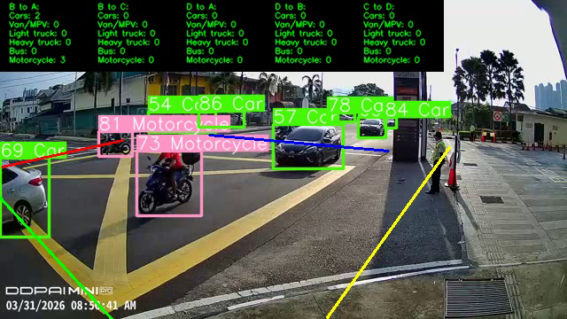
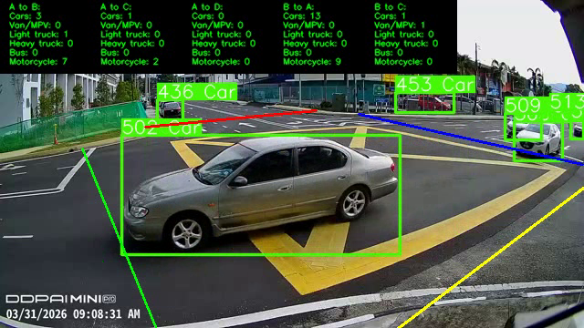
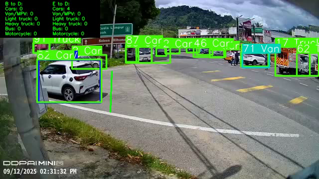

# Traffic Flow Analytics: Multi-Lane Counting and a Directional State Machine

Part of my [applied computer vision portfolio](https://github.com/mh-masum6875/enterprise-computer-vision-solutions).

[](https://ultralytics.com/)
[](https://github.com/nwojke/deep_sort)
[](https://opencv.org/)
[](https://openpyxl.readthedocs.io/)
[](https://opensource.org/licenses/MIT)

An advanced traffic intelligence system designed for multi-lane urban junctions and highway corridors. Features a 6-line virtual trajectory state machine, dynamic day/night threshold adaptation, and automated interval volume reporting.

---

## System In Action

### 1. Daytime Multi-Lane Intersection Tracking
Live tracking showing virtual detection lines (Line A, B, C, D) and directional matrix breakdown across vehicle types.


### 2. Nighttime Dynamic Threshold Adaptation
Maintains continuous tracking in low-light and high-glare conditions with automatic confidence scaling.


### 3. Highway Corridor Flow Counting
Directional flow classification on multi-lane highways with automated volume aggregation.


---

## Core Algorithmic Architecture

### 1. Multi-Line Directional Trajectory State Machine
The system projects 6 virtual detection vectors:
- **Line A**: Entry Northbound
- **Line B**: Entry Southbound
- **Line C**: Turning Corridor East
- **Line D**: Exit Arterial West
- **Line E**: Auxiliary Slip Lane
- **B Supporter**: Collision Filter Vector

Tracks execute a rule-based state machine:
- **AB**: $A \rightarrow B$ (Simple or C-ignored transit)
- **AD**: $A \rightarrow D$ (Straight transit)
- **BA**: $B \rightarrow D (\text{ignored}) \rightarrow A$
- **BC**: $B \rightarrow D (\text{ignored}) \rightarrow C$
- **CA**: $C \rightarrow A$ (Center 50% BBox constraint to eliminate clipped corner false triggers)
- **CD**: $C \rightarrow B \text{ or } E$
- **DC**: $D \rightarrow A$ requiring $\ge 10$ continuous confirmation frames.

### 2. Dynamic Day/Night Lighting Adaptation
Ambient luminosity is sampled in real-time using `is_daytime(frame)`:
- **Motorcycle Confidence (Day)**: `0.10`
- **Motorcycle Confidence (Night)**: `0.01` (prevents lost tracks caused by headlight glare and back-reflections)
- **Buffer Retention**: 15-frame history with 5-frame debounce for heavy vehicles.

### 3. Vehicle Classification & Automated Excel Generation
Categorizes traffic into:
- **Trucks**: Standard Truck, Heavy Truck, Pickup Truck, Machinery Vehicle
- **Buses**: Public Transit & Coach
- **Light Vehicles**: Passenger Car, SUV, Van, Motorcycle

Aggregates data directly into interval sheets (15-min / hourly matrices) compatible with municipal traffic management standards.

---

## Quickstart & Setup

```bash
# Clone the repository
git clone https://github.com/mh-masum6875/traffic-flow-analytics.git
cd traffic-flow-analytics

# Install dependencies
pip install -r requirements.txt
```

### Running Traffic Flow Tracker:
```bash
python src/multilane_flow_tracker.py --source data/traffic_sample.mp4 --conf 0.25
```

---


---

## Related Analytics

In addition to the multi-lane junction tracker included in this repository, this algorithmic architecture supports advanced municipal traffic analytics:

- **One-Way & Wrong-Way Transit Detection**: Vector-based trajectory tracking immediately flagging wrong-way vehicles entering ramps or one-way avenues.
- **Perspective-Calibrated Speed Estimation**: Real-time velocity computation leveraging known roadway geometric markers with perspective transformation.
- **Tailgating & Stopping Distance**: Dynamic spatial gap analysis calculating inter-vehicle headway time in seconds.
- **Micromobility & Asset Protection**: Bicycle and motorcycle parking bay monitoring with unauthorized removal and theft alerts.
- **Logistics Loading Dock Turnaround**: Automated arrival-to-departure timestamping measuring truck unloading durations and dock utilization rates.

## License
This project is licensed under the MIT License.
